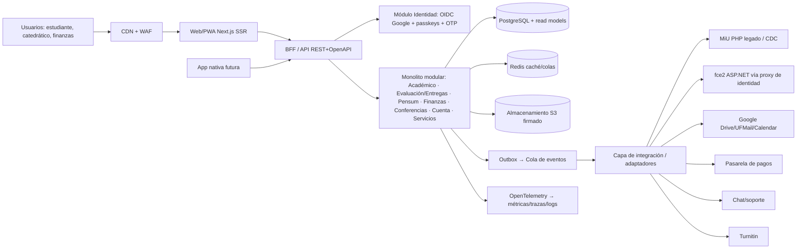

# Análisis de arquitectura — MiU mejorado (proyecto personal e independiente)

- Fecha: 2026-10-22, actualizado con los avisos de seguridad de Node y PHP del 21-oct-2026 (America/Guatemala, UTC-6) · Autor: AlphaGod · Para: Luis
- Base: `ANALISIS_MIU.md` (funciones, P0–P2) y `rea_y_publico.md`. **Solo análisis: sin código y
  sin UI/estética.**
- Etiquetas: **(Hecho)** verificado con una fuente o una observación · **(Inferido)** ·
  **(Supuesto)**, porque no conocemos el stack interno real de la UFM · **(Recomendación)**.
- Límite: **no conocemos la infraestructura interna de UFM IT**. Todo lo que dependa de ella está
  marcado como supuesto, y las preguntas para UFM IT están en §11.

---

## 0. Respuestas de Luis (mapeadas a §12 de ANALISIS_MIU.md)

| # | Insumo | Respuesta de Luis | Tratamiento |
|---|---|---|---|
| 1 | Alcance | Sí, todos: estudiante, catedrático/auxiliar, financiero y servicios | RBAC multi-rol desde el día 1 |
| 2 | Datos/integración | No sabe cuál conviene | **Recomendación razonada en §3** |
| 3 | Sistemas externos | Se mantienen todos, pero hay que mejorarlos | Capa de adaptadores (§6) |
| 4 | Autenticación | Google (solo @ufm.edu) + cuenta propia (solo emails @ufm.edu); le gustó el login de Transparent Labs; teléfono es opcional | §4 |
| 5 | Modelo de datos | Mantener las entidades actuales y mejorar el almacenamiento (visibilidad y rendimiento) | §7 |
| 6 | No funcionales | Evaluar todo lo necesario | §9 |
| 7 | Privacidad | De acuerdo | §8 |
| 8 | Plataformas | ¿Cuál es mejor? | **Recomendación en §10** |
| 9 | fce2 / campus | Mantenerlo solo-campus por los ataques; inventario de dispositivos; un dispositivo nuevo se verifica en la red local | **Evaluación en §5** |
| 10 | Prioridad | Mantener todo lo importante | Plan por fases (§12) |

---

## 1. Resumen ejecutivo

- **Arquitectura recomendada:** un **monolito modular**, con módulos por dominio (académico, evaluación/entregas, pensum,
  finanzas, conferencias, cuenta/identidad, servicios/recursos). Encima, un **BFF/API** tipado. Debajo, **PostgreSQL**
  con **read models** y **Redis**. Al lado, una **capa de integración con adaptadores** (MiU PHP legado, fce2, Google,
  pagos, chat, Turnitin). La migración es **strangler-fig**, por módulo. **No** recomendamos microservicios al inicio.
- **Respuesta 2 (datos):** usar una **API/réplica de lectura oficial con CDC** cuando UFM la conceda. Mientras tanto,
  trabajar con **adaptadores contra contratos documentados y datos de prueba o exportados por Luis**. **No** recomendamos
  un "puente/scraping" que use la sesión del usuario contra MiU como base permanente. Ver §3.
- **Respuesta 8 (plataformas):** primero una **web responsive instalable (PWA)** con SSR, sobre una API compartida. El
  nativo (Kotlin/Compose Multiplatform, que Luis ya conoce por Senda) entra después, solo si hay una necesidad nativa
  concreta. Ver §10.
- **Login de Transparent Labs (hecho):** no es un sistema propio. Es el **portal de clientes de Skio** (app de
  suscripciones para Shopify), servido en `/a/account` mediante un *App Proxy* de Shopify como una app Next.js. Su
  flujo es **passwordless**: un **código de 4 dígitos por email (y SMS solo en EE. UU./Canadá)**, más un **magic link**,
  ambos con vigencia de 10 minutos y con la opción de contraseña habilitada. **No encontramos evidencia de detección
  de dispositivo.** Esa sensación casi seguro viene de la sesión recordada o del autocompletado (Inferido). Lo
  aplicable a MiU es el **OTP por email + magic link + "recordar dispositivo"**, y lo mejoraríamos con **passkeys**.
- **Idea de "dispositivos verificados solo en la red del campus" (veredicto):** la **intención es correcta**, porque
  agrega un factor de posesión y una ceremonia de enrolamiento presencial. Pero **la red por sí sola no identifica
  un dispositivo**: las IP se comparten (NAT) y se falsean con proxies o VPN, y las MAC se aleatorizan y se clonan.
  La huella del navegador se puede imitar. **Recomendación híbrida:** **enrolar en el campus** una **credencial
  criptográfica atada al dispositivo** (passkey/WebAuthn, o certificado de dispositivo vía MDM para equipos de la
  UFM) y exigirla para fce2. La red del campus queda como **una señal más**, no como el control. Esto va junto con
  WAF, rate limiting y un inventario con revocación. Ver §5.

---

## 2. Decisiones de arquitectura (tabla)

| Decisión | Opciones | Recomendación | Por qué | Riesgo |
|---|---|---|---|---|
| Estilo | Monolito modular · microservicios · mantener PHP | **Monolito modular** con límites de dominio | Equipo pequeño (Claude + Luis), transacciones entre dominios (solvencia→notas) y menor costo operativo. Se puede extraer un módulo después | Fronteras débiles si no se aplican reglas de dependencia |
| Backend | TypeScript (NestJS/Fastify) · Kotlin (Ktor/Spring) · PHP moderno (Laravel) | **TypeScript (Node, NestJS o Fastify)**. Alternativa fuerte: Kotlin/Ktor | Un solo lenguaje con el front, tipos compartidos y ecosistema grande. Kotlin sería preferible si se prioriza reutilizar lo de Senda (KMP) | Elegir dos lenguajes sin necesidad |
| Front | Next.js (React, SSR) · SvelteKit · SPA pura | **Next.js (SSR + PWA)** | SSR para el primer render rápido y deep links reales; ecosistema y accesibilidad | Complejidad SSR/caché |
| API | REST+OpenAPI · GraphQL · tRPC | **REST + OpenAPI**, con un BFF para la web | Contratos explícitos, consumibles por la app nativa y por terceros; cacheable | Sobre/sub-fetching (lo mitiga el BFF) |
| BD | PostgreSQL · MySQL · NoSQL | **PostgreSQL** | Relacional (pensum como grafo, notas ponderadas, pagos), JSONB, FTS, RLS para visibilidad | Diseño de índices |
| Caché/lecturas | Redis · vistas materializadas · read models | **Read models** por pantalla (proyecciones) + **Redis** | Ataca el P0 de rendimiento (hoy 60 s–>2 min) | Coherencia eventual |
| Búsqueda | Postgres FTS · OpenSearch/Meilisearch | **Postgres FTS** al inicio; motor dedicado solo si hace falta | Menos piezas | Límites de relevancia |
| Archivos | Disco local · S3-compatible · Google Drive | **Almacenamiento S3-compatible** con URLs firmadas; Drive se mantiene como integración | Entregas y documentos con control de acceso y antivirus | Costo de egress |
| Notificaciones | Email · push web · push nativo · SMS | **Email + Web Push**; push nativo después; SMS solo para alertas críticas | Costo/beneficio; SMS es caro y débil | Push en iOS solo si la PWA está instalada |
| Integración | Llamadas directas · capa de adaptadores + outbox/colas | **Adaptadores (anti-corruption layer)** + **outbox** + cola | Aísla lo legado (PHP, fce2, ASP.NET) y permite reintentos | Doble escritura sin outbox |
| Migración | Big-bang · strangler-fig | **Strangler-fig por módulo** | Riesgo bajo, valor temprano | Convivencia prolongada |
| Auth | Contraseña · OTP email · passkeys · SMS · Google OIDC | **Google OIDC (hd=ufm.edu + verificación en servidor) + cuenta propia passwordless (OTP email/magic link) + passkeys**; SMS opcional, no como factor fuerte | Seguridad y experiencia (el estilo Transparent Labs) | Entregabilidad del email |
| Confianza de dispositivo (fce2) | Solo red del campus · huella · passkey atada al dispositivo · mTLS/MDM | **Enrolamiento presencial en el campus de una passkey/certificado** + red como señal + WAF/rate limit | Un control criptográfico no se falsea con IP o MAC | Fricción del enrolamiento; pérdida del dispositivo |
| Plataformas | Web · PWA · nativo · KMP | **Web/PWA primero**; nativo después | Una sola base, deep links, alcance inmediato | Límites de PWA en iOS |
| Parches (nuevo) | Ad hoc · política con SLA | **Renovate + SCA/SBOM + SLA (crítica ≤48 h, alta ≤7 d) + Node LTS ≥24.22.1** | Avisos de Node y PHP del 21-oct-2026 | No cumplir el SLA |
| Observabilidad | Logs sueltos · OpenTelemetry | **OpenTelemetry** (trazas, métricas, logs) + SLOs | Hoy no hay visibilidad | Costo de retención |

---

## 3. Respuesta 2 — ¿API/BD oficial o puente/scraping?

**Opciones**
1. **API oficial o réplica de lectura con CDC** (Change Data Capture, p. ej. Debezium sobre la BD de MiU)
   alimentando nuestros read models. *(Supuesto: requiere que UFM IT lo conceda)*
2. **Puente/scraping** que usa la sesión del estudiante contra las páginas PHP actuales.
3. **Datos propios/exportados**: para el prototipo personal, datos de prueba realistas basados en el modelo de
   dominio, más las exportaciones que Luis tenga de su propia cuenta.

**Comparación**
- **(1)** Es la única base correcta para producción: rendimiento, consistencia, legalidad y auditoría. El riesgo es
  depender de que UFM coopere.
- **(2)** Es frágil, porque cualquier cambio de HTML lo rompe. Además **hereda la lentitud** (60 s–>2 min), obliga a
  **manejar credenciales o sesiones de terceros**, puede violar los términos de uso y se acerca a "evadir controles",
  algo que nos prohibimos.
- **(3)** No tiene riesgo y permite construir y validar toda la arquitectura, los contratos y el rendimiento hoy.

**Recomendación:** **(3) ahora + (1) como destino.** Diseñamos **adaptadores detrás de interfaces (puertos)**: un
`FakeMiUAdapter` con datos de prueba para el desarrollo y un `OfficialMiUAdapter` (API/CDC) cuando exista. **(2) se
descarta** como base. Como mucho serviría para una herramienta personal de Luis sobre **sus propios datos**, con su
consentimiento explícito, sin almacenar su contraseña y sin tocar datos de terceros. El análisis del APK (REA) sirve
para **documentar contratos**, no para consumir la API sin permiso.

---

## 4. Autenticación e identidad

### 4.1 El login de Transparent Labs: qué es realmente
- **(Hecho)** `https://www.transparentlabs.com/a/account/login` responde `200`, con `powered-by: Shopify` y servido
  por Cloudflare. El HTML es una app **Next.js** montada en `/a/account` (`_next/static/...`, `id="skio-root"`,
  `data-skio-name`, `customerPortalVersion: 3`, `showPasswordLogin: "true"`, `loginEmailStepFooter`). La ruta y la
  firma del querystring (`shop`, `path_prefix`, `timestamp`, `signature`) corresponden a un **Shopify App Proxy**.
  Obtenido con curl; no creamos cuenta ni enviamos nada.
- **(Hecho, documentación de Skio)** Login passwordless: se ingresa el email, se presiona "Get login code" y llega un
  **código de 4 dígitos por email**, y **por SMS solo si hay un teléfono de EE. UU. o Canadá**. El código **dura 10
  minutos** y se bloquea tras **5 intentos fallidos**. El mismo email trae un **magic link** que también expira en 10
  minutos. Fuentes: help.skio.com.
- **(Inferido)** La "detección de dispositivo" que percibió Luis **no aparece en el HTML**. Lo más probable es una
  cookie de sesión persistente, el autocompletado del navegador o del sistema operativo (iOS y Android sugieren el
  código del SMS o del email) y la sesión de Shop/Shopify. No vimos passkeys en esta página.
- **Lo aplicable a MiU:** el flujo de **un solo campo (email) → código → adentro**, el magic link, la expiración
  corta, el límite de intentos y **"recordar este dispositivo"**. **Lo que mejoramos:** usar un código de 6 dígitos
  (no de 4), agregar passkeys, aplicar riesgo adaptativo y restringir al dominio.

### 4.2 Diseño recomendado
1. **Google OIDC (Workspace UFM):** usar el parámetro `hd=ufm.edu` **solo como pista de UI**. **En el servidor hay
   que validar** el ID token (firma, `aud`, `iss`, `exp`), además de `email_verified=true` y que el claim `hd` sea
   igual a `ufm.edu`. Google advierte que `hd` en la petición no basta, porque el usuario puede alterarlo.
2. **Cuenta propia, solo para @ufm.edu:**
   - Alta solo después de **verificar la propiedad del email @ufm.edu** con un OTP.
   - **Login passwordless:** OTP de 6 dígitos o magic link, de un solo uso, con vigencia de 10 minutos, código
     guardado como hash, rate limit por cuenta, IP y dispositivo, y un mensaje que no revele si la cuenta existe.
   - **Passkeys (WebAuthn/FIDO2)** como método preferido. Resisten el phishing y quedan atadas al dispositivo o
     sincronizadas por el proveedor.
   - Contraseña: **opcional o ninguna**. Si se ofrece, seguir NIST 800-63B: longitud mínima de 8 (se recomiendan
     15 o más), revisión contra contraseñas filtradas, sin reglas de composición y sin rotación forzada.
3. **Vinculación de identidades:** las identidades Google y propia se unen por un **sujeto interno estable** (no
   por el email solo), vinculándolas explícitamente tras autenticarse en ambas.
4. **Teléfono/SMS:** **no como factor fuerte**. NIST lo trata como **restringido** (riesgo de SIM swap y de
   interceptación SS7), y además tiene costo por mensaje y entregabilidad variable en Guatemala (Supuesto). Sirve
   para **avisos**, no para autenticar. Si Luis lo quiere, que sea un canal de recuperación con controles extra.
5. **MFA por riesgo:** con passkey no hace falta un segundo factor. Con OTP por email, pedir un **step-up** (passkey
   o un segundo factor) para acciones sensibles: pagos, Asignar/Botar, cambio de datos personales y fce2.
6. **Sesiones y dispositivos:**
   - Cookies `HttpOnly; Secure; SameSite=Lax`, rotación al autenticarse y expiración inactiva y absoluta.
   - Lista de **sesiones y dispositivos activos** con la opción de **cerrar sesión remota**.
   - "Recordar dispositivo" mediante un token atado al dispositivo, revocable.
   - La pantalla "Mis accesos" actual evoluciona a una bitácora de seguridad.
7. **Recuperación de cuenta:** por el email @ufm.edu (que gestiona UFM) más passkey de respaldo. Para casos sin
   acceso, **verificación presencial** (oficina o campus) con auditoría. Nada de preguntas secretas.
8. **Autorización:** **RBAC** por rol (estudiante, catedrático, auxiliar, finanzas, admin) más **ABAC** por recurso
   - *Corrección (22-oct-2026):* en la UFM los **Auxiliares califican, publican notas y gestionan tareas y exámenes** de sus secciones asignadas. El **Maestro** es dueño del curso: asigna auxiliares por sección, revisa o sobrescribe y ve la auditoría. El permiso configurable `cerrar_nota_final` es por defecto solo del Maestro (*supuesto a confirmar con la UFM*). La justificación de nota baja y la auditoría aplican a quien califique. Detalle en `FUNCIONES_NUEVAS_Y_PAGOS.md` §3.
   (solo tus notas; el catedrático solo ve sus secciones). Aplicarlo en el servidor y reforzarlo con **RLS** de
   Postgres.

---

## 5. Evaluación de la idea "dispositivos confiables enrolados solo en la red del campus" (fce2)

**Intención de Luis:** fce2 sufrió ataques. Él quiere que solo los dispositivos verificados en la red local del
campus puedan usarlo, con un inventario de dispositivos, y que cada dispositivo nuevo se verifique en esa red.

### 5.1 Qué protege
- Reduce la superficie expuesta: fce2 no es alcanzable desde internet, lo que frena el escaneo masivo y los ataques
  automatizados remotos.
- Agrega una **ceremonia de enrolamiento presencial**, con valor real como factor de "presencia física".
- Un inventario permite **revocar** y **auditar**.

### 5.2 Qué NO protege, o protege mal
- **La IP identifica una red, no un dispositivo.** Detrás de NAT, cientos de equipos comparten la IP del campus.
  Cualquier equipo comprometido dentro de la red, o un visitante en el Wi-Fi, "parece" del campus.
- **VPN, proxies y túneles:** si existe una VPN institucional o un equipo del campus que haga de pivote, el control
  por red se rodea.
- **MAC:** iOS, Android y Windows **aleatorizan la MAC por red**, y una MAC **se clona trivialmente**. No sirve como
  identidad.
- **Huella del navegador (fingerprint):** es probabilística, cambia con las actualizaciones y **se puede imitar**.
  Sirve como señal de riesgo, no como credencial.
- **Amenaza interna y robo de sesión:** si un atacante roba una cookie de sesión válida, el control de red no ayuda
  cuando el atacante también está en el campus.
- **HTTP plano (Hecho, en ANALISIS_MIU):** la evaluación de conferencias en fce2 viaja **sin TLS**. En la red local
  eso permite **leer y modificar el tráfico**. Es más grave que el problema de acceso.

### 5.3 Estándares mejores
- **Passkeys / WebAuthn con attestation:** la clave privada vive en el hardware del dispositivo (TPM, Secure
  Enclave). Es **resistente al phishing** y no se puede copiar como una IP o una MAC.
- **Certificados de dispositivo (mTLS)** emitidos por **MDM** (Intune, Jamf, Google Endpoint Management) para los
  **equipos de la UFM**.
- **Zero Trust / BeyondCorp (Google):** el acceso depende de la **identidad, el estado del dispositivo y el
  contexto**, no de "estar dentro de la red". Encaja con los ataques que se buscan frenar.
- Además: **HTTPS obligatorio + HSTS**, **WAF**, **rate limiting**, bloqueo progresivo, **detección de anomalías**
  y **auditoría inmutable**.

### 5.4 Híbrido recomendado (mantiene la intención de Luis)
1. **Enrolamiento presencial:** un dispositivo nuevo solo se puede enrolar **estando en el campus**. La red se usa
   como señal, junto con un código mostrado en un punto físico o la validación de personal. En ese momento se
   registra una **passkey atada al dispositivo** (o un certificado MDM si es un equipo de la UFM).
2. **Inventario de dispositivos:** cada dispositivo guarda dueño, tipo de credencial, fecha de enrolamiento y
   último uso, con **revocación inmediata** y alertas cuando aparece uno nuevo.
3. **Acceso a fce2:** se exigen **identidad (SSO) + credencial del dispositivo enrolado**. La pertenencia a la red
   del campus es **un factor adicional opcional**, o "solo campus" si UFM lo decide, pero nunca el único control.
4. **Endurecer fce2:** TLS en todo, WAF delante, rate limiting y registro de auditoría. Idealmente, poner fce2
   **detrás de un proxy de acceso con identidad** (por ejemplo un Identity-Aware Proxy), en lugar de exponerlo.
5. **Fuera del campus:** queda deshabilitado, o habilitado solo con un dispositivo ya enrolado más un step-up, según
   la política de UFM.

**Veredicto:** la idea es **buena como ceremonia de enrolamiento** y **mala como control único**. Con passkeys o
certificados atados al dispositivo cumple lo que Luis busca.

---

## 6. Arquitectura objetivo

- **Módulos (bounded contexts):**
  - Identidad y Acceso
  - Académico: cursos, secciones, horario, inscripción
  - Evaluación y Entregas: esquema ponderado, actividades, entregas, notas
  - Pensum: grafo de prerrequisitos, UMA, requisitos
  - Finanzas: cargos, saldo, solvencia, recibos
  - Conferencias
  - Cuenta y Privacidad
  - Servicios y Recursos
  - Comunicación: anuncios, foro, blog, chat
  - Notificaciones
- **Reglas:** cada módulo es dueño de sus tablas (esquema por módulo) y los demás le hablan por su API interna o por
  eventos, nunca por SQL cruzado.
- **Solvencia → notas:** es una **política** dentro de Evaluación que consulta un puerto `SolvenciaPort` de Finanzas.

### 6.1 Integración (adaptadores)
- **MiU PHP legado:** primero en modo lectura, vía CDC o API (§3). Las escrituras críticas, como Asignar/Botar,
  se dejan en el sistema legado hasta migrarlas.
- **fce2:** detrás de un proxy de identidad, aplicando el híbrido de §5.
- **Google:** OAuth con **consentimiento explícito y anticipado**. Esto corrige la "sorpresa" de "Programa del
  curso".
- **Pagos:** **nunca guardar datos de tarjeta**. Usar una pasarela con tokenización y alcance PCI reducido
  (SAQ A/A-EP). Los webhooks se firman y se procesan de forma idempotente.
- **Chat (providesupport):** se mantiene y se **prellena la identidad** con un token firmado. Más adelante se puede
  evaluar reemplazarlo.
- **Turnitin:** integración vía LTI 1.3. *(Supuesto: depende del contrato de UFM)*
- **Sistemas legados como no confiables (nuevo, 22-oct-2026):** el MiU PHP y fce2 se tratan como **zona no confiable**. Los adaptadores validan y sanean todas las respuestas con un esquema estricto, usan credenciales de mínimo privilegio y solo lectura cuando se puede, y nunca reenvían cookies ni sesiones del usuario. Además aplican timeouts, límites de tamaño, aislamiento de red (egress solo hacia los hosts autorizados) y auditoría. *Contexto:* el 21-oct-2026 PHP publicó parches para dos RCE críticas sin autenticación (CVE-2026-109618/109619, CVSS v4 9.2), y el riesgo más alto lo tiene `mod_php`. MiU corre sobre Apache, así que **inferimos** que podría usar `mod_php`, pero **no conocemos su versión de PHP ni su configuración y no afirmamos que sea vulnerable**. Esto pasa a ser una pregunta y una recomendación para UFM IT (§11).
- **Patrón:** **outbox transaccional**, reintentos con backoff, idempotencia, *circuit breaker*, y un timeout por
  llamada.

### 6.2 Migración strangler-fig
Un enrutador o proxy delante del sistema manda cada ruta, según el módulo, al sistema nuevo o al legado. Cada
módulo pasa por estos pasos: (1) lectura espejo, (2) validación paralela, (3) corte, y (4) retiro del código
legado.

---

## 7. Datos: almacenamiento con visibilidad y rendimiento (respuesta 5)

- **Modelo canónico normalizado** en Postgres con las entidades de ANALISIS §5. El pensum es un **grafo dirigido**
  (tabla de prerrequisitos) y las notas usan el **esquema ponderado** (componentes con un peso cuya suma se valida
  en 100).
- **Read models:** tablas o vistas materializadas por caso de uso, por ejemplo "cursos actuales del estudiante",
  "pendientes agregados" o "estado de cuenta". Se actualizan por eventos. Esto ataca directamente los 60 s–>2 min
  de hoy.
- **Una sola fuente de verdad para los contadores:** el badge de Pendientes se calcula desde el **mismo read model**
  que la lista. Así se elimina la inconsistencia observada.
- **Visibilidad:** RLS por estudiante, sección y rol. Columnas PII **cifradas** (CUI, fecha de nacimiento) y
  **enmascaradas** por defecto. El roster depende de las opciones de privacidad.
- **Auditoría:** tabla *append-only* con quién, qué, cuándo y desde qué dispositivo, para cambios de notas, pagos,
  asignaciones y datos personales.
- **Índices y paginación:** keyset pagination, índices compuestos por (estudiante, período), y nada de N+1 (se
  resuelve con consultas agregadas o con el read model).
- **Retención y respaldo:** PITR (point-in-time recovery), respaldos cifrados y pruebas de restauración.

---

## 8. Seguridad y privacidad (respuesta 7)

- **HTTPS en todo** con HSTS (`preload`). **Cero formularios por HTTP**, lo que corrige fce2.
- **CSP estricta** (nonce/hash, sin `unsafe-inline`), `frame-ancestors`, `X-Content-Type-Options`,
  `Referrer-Policy`, `Permissions-Policy` y SRI para scripts de terceros. Revisar cada tercero que se incrusta.
- **Minimización de PII:** no mostrar el CUI completo (por ejemplo `•••••••0101`), mostrar la fecha de nacimiento
  solo a su dueño y con step-up, y la foto en el roster solo con consentimiento.
- **OWASP ASVS nivel 2** como lista de verificación. Defensa contra CSRF, SSRF e IDOR (los IDs opacos se mantienen,
  pero la autorización se verifica siempre).
- **Secretos** en un gestor dedicado. **Rotación de llaves.** Dependencias escaneadas con SCA y SBOM.
- **Rate limiting y WAF** en el login, el OTP y fce2.

---

## 8b. Política de parches y dependencias *(nuevo, 22-oct-2026; las cifras son propuestas)*

**Detonante (Hecho):** el 21-oct-2026 Node.js publicó las versiones de seguridad **26.12.1, 24.22.1 y 22.23.4**.
La severidad máxima es **HIGH** e incluye:
- **escritura fuera de límites en el decodificador Brotli que permite RCE** (CVE-2026-111497);
- dos evasiones de validación del hostname TLS (CVE-2026-105483 y CVE-2026-106069);
- truncado de nombres con NUL en `dns.resolve` (CVE-2026-105482);
- entropía repetida de `crypto.randomUUID()` y `randomInt()` en snapshots y SEAs (CVE-2026-106074, medium);
- dependencias actualizadas: OpenSSL, c-ares, Undici y CA.

El mismo día **PHP** corrigió dos RCE críticas sin autenticación. **Las versiones fuera de soporte siempre quedan
afectadas.**

Política:
1. **Runtime:** solo **Node LTS con soporte**, **mínimo 24.22.1** (o una LTS más nueva y parcheada). Nunca una
   versión EOL. La versión se fija en `.nvmrc`/`engines` y en la imagen base. Una alerta salta si la LTS entra a su
   último trimestre de soporte. No usaremos snapshots ni SEA salvo con una versión corregida.
2. **Actualización automática:** **Renovate** (o Dependabot) con agrupación por ecosistema, *lockfile* obligatorio
   y auto-merge solo para parches que pasen CI.
3. **SCA y SBOM:** `npm audit` / OSV-Scanner en cada PR y cada noche, un **SBOM CycloneDX** por build, firma de
   artefactos y el CI falla ante una vulnerabilidad crítica o alta explotable.
4. **SLA de parcheo (propuesta):** crítica **≤ 48 h**; alta **≤ 7 días**; media **≤ 30 días**; baja en el
   siguiente ciclo. Si existe un exploit público o una RCE sin autenticación, se trata como crítica.
5. **Contenedores:** imagen base mínima (distroless o slim) con un **rebuild semanal** y otro inmediato cuando hay
   un aviso, un escaneo de la imagen (Trivy/Grype) y ningún paquete innecesario.
6. **Despliegue:** primero a **staging**, con pruebas automáticas, smoke tests y canario. Luego producción, con
   rollback probado.
7. **Fuente de alertas:** el agente **Noticias Tech** (monitorea noticias de seguridad para desarrolladores) avisa
   al flujo. Cada aviso relevante abre una tarea con la severidad y el SLA de arriba; se verifica contra el aviso
   oficial antes de actuar.
8. **Defensa en profundidad para Node:** límites de tamaño y descompresión en el borde (proxy/WAF, máximo de bytes
   decodificados), deshabilitar la descompresión de entradas no confiables cuando no haga falta, validación TLS
   estricta (sin hosts escritos como IP "raras") y que `crypto` no salga de snapshots.

### Reevaluación de Next.js / Node
- **Se mantiene.** Los CVE de octubre afectan a **todas** las líneas con soporte (22, 24 y 26) y se corrigieron
  el mismo día. Esto muestra un proceso de seguridad maduro, no un defecto del stack. Cualquier runtime (JVM,
  .NET, PHP) tiene avisos parecidos; el riesgo real está en **no parchear**. Cambiar a Kotlin/Ktor no elimina el
  problema; lo traslada a la JVM y a Netty.
- **Mitigaciones de arquitectura:**
  - Next.js solo como capa de presentación/BFF. La lógica sensible vive en el monolito modular.
  - Exposición mínima detrás del CDN/WAF.
  - Política de parches §8b.
- **Condición para reconsiderarlo:** si el equipo no puede cumplir el SLA de parcheo, una opción con menos
  superficie de servidor (SSG con hosting gestionado) o Kotlin/Ktor se vuelve más atractiva. La recomendación
  principal **no cambia**.

---

## 9. No funcionales (respuesta 6) — presupuestos propuestos *(Recomendación)*

| Atributo | Meta propuesta |
|---|---|
| Primer render útil (LCP) | < 2.5 s p75 en móvil 4G (Core Web Vitals) |
| Interactividad (INP) | < 200 ms p75 |
| Estabilidad (CLS) | < 0.1 |
| API lectura | p95 < 300 ms; p99 < 1 s |
| Timeouts | ≤ 10 s en integración, con reintento idempotente y error visible |
| Disponibilidad | SLO 99.5 % mensual (99.9 % en periodos de asignación) |
| Accesibilidad | WCAG 2.2 AA como requisito técnico (semántica, foco, contraste, sin modales bloqueantes) |
| i18n | UTF-8 de punta a punta; ES base, EN secundario; sin traductor externo |
| Observabilidad | OpenTelemetry; SLOs y alertas por endpoint; tasa de error < 1 % |
| Seguridad | ASVS L2; 0 formularios HTTP; CSP sin `unsafe-inline` |

---

## 10. Respuesta 8 — ¿Web, PWA o nativo?

| Opción | A favor | En contra |
|---|---|---|
| **Web responsive + PWA (SSR)** | Una sola base de código, deep links, SEO interno, instalable, push web (en iOS ≥16.4 solo con la PWA instalada), despliegue inmediato | Menos acceso nativo; push limitado en iOS |
| Nativo puro (Swift + Kotlin) | Mejor integración con el sistema | Duplica el costo y la paridad es difícil |
| Compose/Kotlin Multiplatform | Luis ya lo conoce (Senda); comparte la lógica | Web de KMP menos madura; dos front-ends |
| React Native/Expo | Comparte lenguaje con la web | Otra capa más |

**Recomendación:** **Web/PWA primero**, con una API compartida y deep links. **Nativo después** solo si un caso lo
exige: push fiable en iOS, widgets o biometría para el step-up (aunque las passkeys ya cubren la biometría en la
web). Si se hace nativo, **KMP/Compose** por la experiencia de Luis. Hoy existe la app oficial `com.miu.ufm`; la
paridad se logra porque ambos clientes consumen la **misma API**.

---

## 11. Supuestos y preguntas que solo UFM IT puede responder

Supuestos: no conocemos la BD de MiU, la versión de PHP, la topología de red, el proveedor de pagos, el contrato de
Turnitin, la existencia de MDM ni la VPN.

Preguntas:
1. ¿Qué motor de BD y versión usa MiU? ¿Se puede habilitar una réplica de lectura o CDC?
2. ¿Existe una API interna, sea la que usa la app `com.miu.ufm`? ¿Está documentada? ¿Hay un ambiente de pruebas?
3. ¿Qué tipo de ataques sufrió fce2 (fuerza bruta, inyección, DDoS, credenciales robadas)? ¿Hay logs?
4. ¿Hay VPN institucional? ¿Wi-Fi con 802.1X/EAP? ¿Existe MDM (Intune, Jamf, Google)?
5. ¿Política de Google Workspace: es posible exigir 2SV o passkeys a todos los @ufm.edu?
6. ¿Qué pasarela de pagos se usa y con qué nivel PCI?
7. ¿Contrato de Turnitin (LTI)? ¿Términos de providesupport y ChatGPT Edu?
8. ¿Política de datos personales (CUI) y retención según la ley guatemalteca y la normativa interna?
9. ¿Requisitos de hosting (on-prem, nube, residencia de datos)?
10. ¿Se permite que un proyecto independiente consuma datos (convenio) o debe quedarse como prototipo con datos de prueba?
11. **(Nuevo)** ¿Qué versión de PHP y qué SAPI (mod_php, FPM) usan MiU y sus servicios PHP? ¿Ya aplicaron 8.5.12, 8.4.27, 8.3.36 u 8.2.35 (21-oct-2026)? Si usan 8.2, hay que planear la migración antes del fin de soporte (31-dic-2026). Si usan 8.1 o anterior, ya no tienen soporte del proyecto PHP. *Recomendación respetuosa a UFM IT, sin afirmar que sean vulnerables.*
12. **(Nuevo)** ¿El stack .NET/IIS de fce2 tiene parches al día? ¿Hay WAF delante?

---

## 12. Plan de migración por fases *(Recomendación)*

| Fase | Contenido | Criterio de salida |
|---|---|---|
| 0. Fundaciones | Repositorio, CI, OpenTelemetry, IaC, modelo canónico, `FakeMiUAdapter` con datos de prueba, ASVS checklist | Pipeline verde; contratos OpenAPI v0 |
| 1. Identidad | Google OIDC (hd + verificación en servidor), OTP/magic link @ufm.edu, passkeys, sesiones y dispositivos, auditoría | Login < 10 s de punta a punta; pruebas de abuso (rate limit) |
| 2. Lectura académica (P0) | Cursos actuales, Horario, Pendientes, Notas, Detalle de curso con read models | LCP < 2.5 s; badge = lista; 0 cuelgues |
| 3. Pensum + historial | Mapa de Cursos (grafo), Cursos anteriores | Paridad funcional con el actual |
| 4. Entregas + documentos | Subida a S3 firmado, antivirus, Turnitin (si aplica) | Integridad del archivo, recibo de entrega |
| 5. Finanzas | Saldo, solvencia, recibos, pago vía pasarela tokenizada | Conciliación 100 %; webhooks idempotentes |
| 6. Conferencias + Asignar/Botar | Escrituras transaccionales con step-up | Cero dobles asignaciones; auditoría |
| 7. fce2 endurecido | Proxy de identidad, enrolamiento de dispositivos en el campus, TLS, WAF | Cero formularios HTTP; inventario operativo |
| 8. Comunicación + servicios | Anuncios, foro, blog, chat prellenado, recursos | Paridad |
| 9. Nativo (opcional) | KMP/Compose sobre la misma API | Caso de negocio validado |

---

## 13. Notas para Claude Code
- Respeta las etiquetas Hecho, Supuesto y Recomendación. **No implementes contra MiU real sin un convenio**; usa
  `FakeMiUAdapter`.
- Fase técnica: skills `impeccable` y `find-skills` *(propuesta)*. La UI se hará después con `emil-design-eng` y
  `apple-design`.
- Entregables siguientes: **contratos OpenAPI**, **esquema de BD canónico (ERD)**, **ADRs** (un registro por
  decisión de §2) y **modelo de amenazas (STRIDE)** para el login y fce2.

---

## 14. Fuentes
- Skio, login passwordless del portal: https://help.skio.com/docs/instructions-for-your-customers-using-customer-portal-v3
- Skio, magic links: https://help.skio.com/docs/magic-login-links
- Skio con las cuentas de clientes de Shopify: https://help.skio.com/docs/using-skio-with-shopifys-new-customer-accounts
- Shopify App Proxy: https://shopify.dev/docs/apps/build/online-store/display-dynamic-data
- Google, validación del ID token y del claim `hd`: https://developers.google.com/identity/openid-connect/openid-connect
- NIST SP 800-63B (autenticadores; SMS restringido; contraseñas): https://pages.nist.gov/800-63-4/sp800-63b.html
- Passkeys / WebAuthn: https://www.w3.org/TR/webauthn-3/ · https://fidoalliance.org/passkeys/
- OWASP ASVS: https://owasp.org/www-project-application-security-verification-standard/
- OWASP Authentication Cheat Sheet: https://cheatsheetseries.owasp.org/cheatsheets/Authentication_Cheat_Sheet.html
- BeyondCorp (Zero Trust de Google): https://cloud.google.com/beyondcorp
- NIST SP 800-207, Zero Trust Architecture: https://csrc.nist.gov/pubs/sp/800/207/final
- Aleatorización de MAC (Apple): https://support.apple.com/en-us/102509
- Patrón Strangler Fig (Martin Fowler): https://martinfowler.com/bliki/StranglerFigApplication.html
- Transactional Outbox: https://microservices.io/patterns/data/transactional-outbox.html
- Core Web Vitals: https://web.dev/articles/vitals
- WCAG 2.2: https://www.w3.org/TR/WCAG22/
- Web Push en iOS 16.4: https://webkit.org/blog/13878/web-push-for-web-apps-on-ios-and-ipados/
- Node.js, versiones de seguridad de octubre de 2026: https://nodejs.org/en/blog/vulnerability/october-2026-security-releases
- PHP, archivo de noticias 2026 (aviso de RCE críticas, EOL de 8.2): https://www.php.net/archive/2026.php
- Renovate: https://docs.renovatebot.com/ · CycloneDX: https://cyclonedx.org/ · OSV-Scanner: https://google.github.io/osv-scanner/
- Página inspeccionada (solo curl, sin cuenta): https://www.transparentlabs.com/a/account/login
